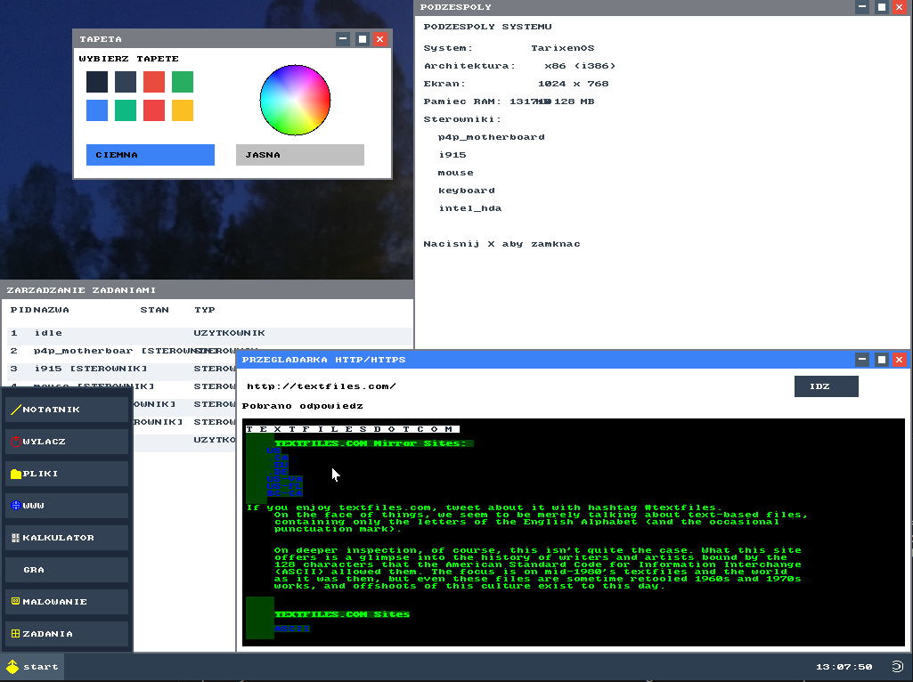
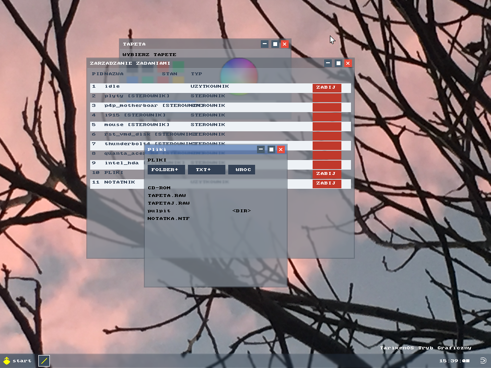
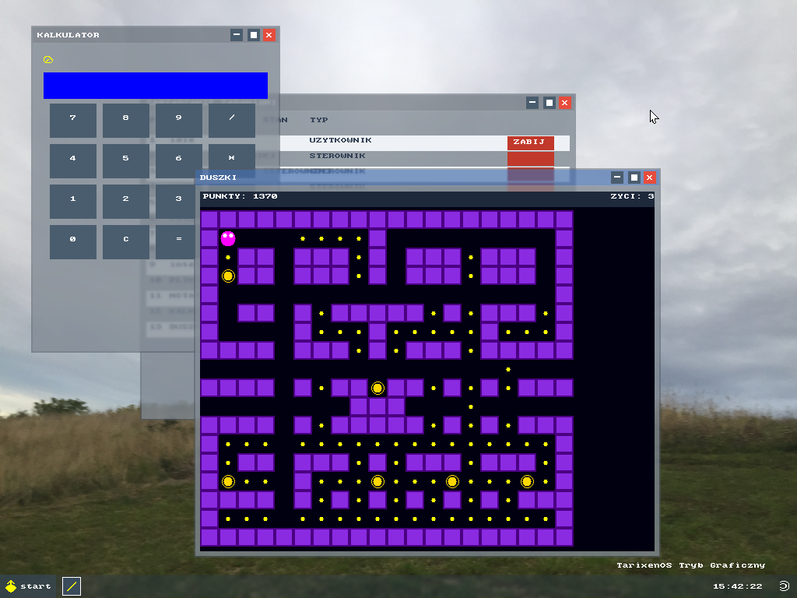

System tarixenOS to graficzny system napisany w C c++ rust i assemblerze który ma za zadanie być zamiennikiem dla systemów korporacyjnych lub tych cięższych, przez co nadaje się na stare komputery. Mile widziane są jakiekolwiek sugestie dotyczące systemu.
jeżeli chcesz dodać jakąś funkcje śmiało wyślij zmiane a ja ją zatwierdze.

## role

- deweloper kernela
- tester
- deweloper od strony użytkownika

# styl pisania kodu

musisz pisać komentarze po polsku i commity po polsku i większość rzeczy po polsku ponieważ to polski projekt
komentarze mają być tylko wtedy jeżeli kod jest w danym miejscu mniej czytelniejszy

WAŻNE: NIE UŻYWAĆ STDINT TYLKO UZYWAJ #include <include/printf/types.h> albo definiuj wlasne typy.

# jak uruchomić?

to zależy czy pobierasz wydanie czy kod zródłowy

## oficjalne wydanie

przy oficjalnym wydaniu wchodzisz do folderu pobrane:

`cd Pobrane`

jesli folder sie nazywa downloads:

`cd Downloads`

ponziej wlaczanie w qemu (chyba ze chcesz na sprzęcie ale nie sądze aby było to możliwe):

`qemu-system-x86_64 -hda tarixenOS.img`

i tyle.

## pobranie kodu zrodlowego

jezeli pobrales sam kod zrodlowy z githuba musisz sam go skompilowac i rowniez nie ma pewnosci ze bedzie dzialac:

wchodzisz do folderu pobrane:

`cd Pobrane`

lub

`cd Downloads`

pozniej wchodzisz do folderu projektu 

`cd tarixenOS-main`
`cd tarixenOS`

i robisz build:

`make`

wchodzisz do niego:

`cd build`

a nastepnie wlaczanie w qemu:

`qemu-system-x86_64 -hda tarixenOS.img`

# screenshoty

