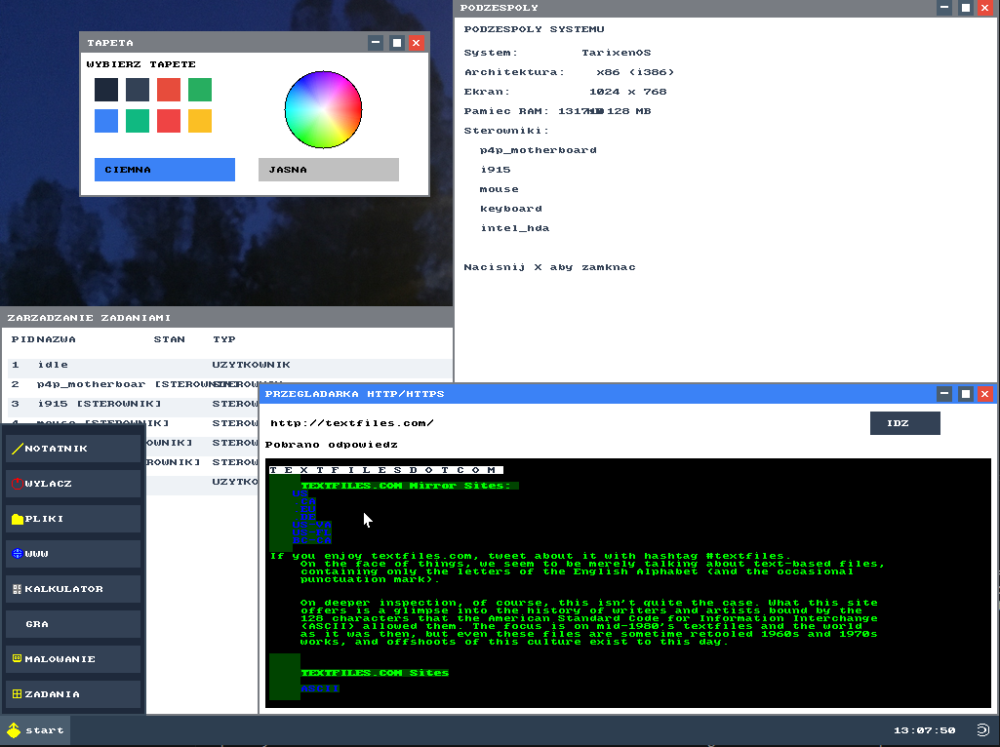

System tarixenOS to graficzny system napisany w C który ma za zadanie być zamiennikiem dla systemów korporacyjnych lub tych cięższych, przez co nadaje się na stare komputery. Mile widziane są jakiekolwiek sugestie dotyczące systemu.
jeżeli chcesz dodać jakąś funkcje śmiało wyślij zmiane a ja ją zatwierdze.

# jak dolaczyc

aby dolaczyc wyslij mi maila na kurczatkojestslodkie@gmail.com i w nim ma byc zawarte:
 - po co chcesz dolaczyc
 - co bedziesz robic dla projektu
 - jaka masz wiedze
 - pokaz wczesniejszy kod jaki robiles w innych projektach

## role

- deweloper kernela
- tester
- deweloper od strony użytkownika

# po co dolaczyc

do projektu warto dolaczyc np. dlatego ze system jest przeznaczony do nauki dzialania systemu, i chce aby wieksza spolecznosc sie nim zainsteresowala.

# co moge zrobic?

mozesz jak wczesniej wspomnialem dolaczyc do pisania systemu albo mozesz tez stworzyc swoj program

## jak zrobic program?

aby dodac swoj program do systemu sa dwa sposoby

### 1. najlatwiejszy

poprostu wysylasz mi kod i ja go dodaje do katalogu kernel/apps/appdownload.

### 3. trudniejszy

bierzesz kod systemu i sam dodajesz aplikacje

# styl pisania kodu

musisz pisać komentarze po polsku i commity po polsku i większość rzeczy po polsku ponieważ to polski projekt
kod masz pisać w C, ponieważ c++ nie nadaje się według mnie bo ma za dużo niepotrzebnych funkcji.

c++ można użyć tylko wtedy gdy pozwole i nie w krytycznych miejscach, tylko w obsłudze użytkownika ale i ta większość w C.

komentarze mają być tylko wtedy jeżeli kod jest w danym miejscu mniej czytelniejszy

# historia

system powstał ponieważ od zawsze chciałem stworzyć system ale nie wiedziałem od czego zacząć, gdy poznałem assembler i C, obejrzałem kilka poradników wziąłem się do roboty. 

# jak uruchomić?

to zależy czy pobierasz wydanie czy kod zródłowy

## oficjalne wydanie

przy oficjalnym wydaniu wchodzisz do folderu pobrane:

`cd Pobrane`

jesli folder sie nazywa downloads:

`cd Downloads`

ponziej wlaczanie w qemu (chyba ze chcesz na sprzęcie ale nie sądze aby było to możliwe):

`qemu-system-x86_64 -hda tarixenOS.img`

i tyle.

## pobranie kodu zrodlowego

jezeli pobrales sam kod zrodlowy z githuba musisz sam go skompilowac i rowniez nie ma pewnosci ze bedzie dzialac:

wchodzisz do folderu pobrane:

`cd Pobrane`

lub

`cd Downloads`

pozniej wchodzisz do folderu projektu 

`cd tarixenOS-main`
`cd tarixenOS`

i robisz build:

`make`

wchodzisz do niego:

`cd build`

a nastepnie wlaczanie w qemu:

`qemu-system-x86_64 -hda tarixenOS.img`

i tyle.

# konwencja commitów

jesli naprawiasz błąd nazwa commitu ma sie zaczynac od: 

naprawa błędu: (jaki blad naprawiles)

jesli dodajesz nowa funkcje napisz na poczatku:

dodano funkcje: (jaka funkcje dodales)

